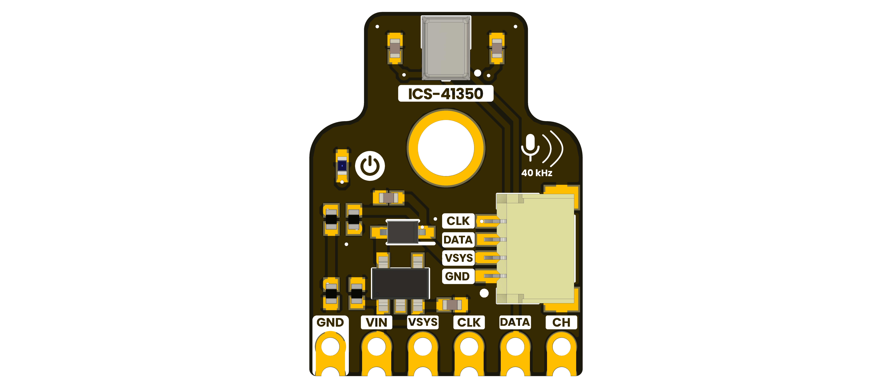

# DevLab: PDM ICS-41350 MEMS Microphone Module

The DevLab PDM ICS-41350 MEMS Microphone is a digital audio module built around
the bottom-port TDK InvenSense ICS-41350. The microphone provides a 1-bit PDM
output and supports low-power, standard, high-performance, and sleep modes
selected by the clock frequency. The BOM identifies an onboard 3.3 V regulator
and indicator LED; the artwork shows channel selection, six castellated
connections, and a four-position 1.0 mm-pitch connector.

  
  
<em>DevLab PDM ICS-41350 MEMS Microphone</em>

### Quick Setup

## Overview

| Feature | Description |
|---|---|
| Product | DevLab PDM ICS-41350 MEMS Microphone |
| MPN | UE0148 |
| Hardware Revision | V1.1 artwork |
| Microphone | TDK InvenSense ICS-41350 bottom-port digital MEMS microphone |
| Module Input Voltage | Pending board-level validation; sensor VDD is 1.65–3.63 V |
| Module Supply Current | Pending board-level validation |
| Sleep Current | 12uA |
| Sensitivity | -26 dB FS |
| Directionality | Omni |
| SNR | 63 dBA |
| Dynamic Range | 89 dB |
| Frequency response | 50 Hz - 20 KHz |
| Ultrasonic response | 40 KHz (High performace mode) |
| PSR | -97 dB FS |
| THD | 0.2% |
| Interface | 1-bit pulse-density modulation (PDM) |
| Exposed Signals | `GND`, `VIN`, `VSYS`, `CLK`, `DATA`, `CH` |
| Regulator | AP2112K-3.3TRG1 fixed 3.3 V LDO, as identified by the BOM |
| Connectors | 1×6 2.54 mm header footprint and 4-position 1.0 mm-pitch connector |

## Applications

- Voice capture and voice-recognition prototypes
- Microphone arrays
- Camera and security or surveillance audio
- Low-power ambient sound analysis and keyword-spotting prototypes
- Ultrasonic sensing experiments using the ICS-41350 high-performance mode

## Resources

- [Schematic Diagram](hardware/unit_sch_v_1_2_1_ue0148_devlab_pdm_ics_41350_mems_microphone.pdf)
- [Pinout Diagram](https://github.com/UNIT-Electronics-MX/unit_devlab_pdm_ics_41350_mems_microphone/blob/main/hardware/README.md#pinout) — artwork-backed pin table
- [Getting Started Guide](https://wiki.uelectronics.com/wiki/devlab-pdm-ics-41350-mems-microphone-)
- [ICS-41350 Datasheet](https://www.invensense.tdk.com/en-us/products/microphone/ics-41350)
- [Arduino library example](software/examples/pdm/cpp_examples/AudioInputBasicRead/AudioInputBasicRead.ino)
- [Software example instructions](software/examples/README.md)

## 📝 License

All hardware and documentation in this project are licensed under the **MIT
License**. See the [repository license](https://github.com/UNIT-Electronics-MX/unit_devlab_pdm_ics_41350_mems_microphone/blob/main/LICENSE)
for details. Third-party reference files may have separate terms.
